# 🔍 PromptLens

**Review the prompts, not just the diff.**

PromptLens is a CLI that links each commit to the Claude Code sessions that produced it and posts one auto-updating comment on the pull request. The comment shows what the developer asked for, what the AI did, what was decided, and whether anything was verified. After a one-time `promptlens init`, developers just commit and push.

[](https://github.com/NewCodes7/promptlens/actions/workflows/ci.yml)
[](https://www.npmjs.com/package/@newcodes/promptlens)

[](LICENSE)

**[Quick start](#quick-start)** · **[Reference](#reference)** · **[Design decisions](#design-decisions)** · **[Live PR report](https://github.com/NewCodes7/promptlens/pull/2)**

<p align="center">
  
  <br>
  <sub><b>Real output.</b> The comment PromptLens posted on <a href="https://github.com/NewCodes7/promptlens/pull/1">this repo's own PR #1</a>.</sub>
</p>

## Why

**Code review is where a team discusses design.** Why this approach, what was ruled out, and whether it was tested all get settled in PR comments, and that's how context spreads through a team.

**With an AI agent, that discussion happens before the PR, in a conversation the reviewer never sees.** By the time the PR opens, these decisions are already made:

- how the developer framed the request, and what they told the agent to avoid
- which alternatives the agent proposed, and which ones the developer rejected
- what the developer answered when the agent asked a question
- whether anyone ran the tests

The reviewer gets only the result. To review the design, they have to reverse-engineer intent from the diff or ask the author to recall a conversation from hours ago. Sharing the whole chat log is noise, and nobody writes the summary by hand.

**Existing tools look at the output.** Linters, rule checks and AI review bots read the diff, and the best of them can infer *why* from it. But the reasoning was never in the diff. It was in the conversation that produced it. So PromptLens records that conversation as it happens: at each commit, it stores the developer's own prompts verbatim, the decisions, and the verification. Then it puts on the PR what a reviewer needs to discuss the design, and marks AI-edited files that have no recorded verification.

This matters more as AI writes more of the code. In [Sonar's State of Code 2026](https://www.sonarsource.com/blog/state-of-code-developer-survey-report-the-current-reality-of-ai-coding/) survey of 1,100+ developers:

- **42%** of committed code is already AI-generated or AI-assisted.
- **38%** say reviewing it takes _more_ effort than reviewing a colleague's code.
- Only **48%** always check it before committing.

## How it works

```mermaid
flowchart LR
  subgraph Dev["Developer machine"]
    CC["Claude Code sessions<br/>~/.claude/projects/*.jsonl"]
    PC["post-commit hook<br/><code>promptlens capture</code>"]
    RAW[".git/promptlens/raw/&lt;sha&gt;.json<br/>(private, never pushed)"]
    SUM["background summarizer<br/>claude -p → OpenAI → heuristic"]
    NOTE["git note<br/>refs/notes/promptlens"]
    PP["pre-push hook<br/><code>promptlens sync</code>"]
    CC --> PC --> RAW --> SUM --> NOTE --> PP
  end
  subgraph GH["GitHub"]
    REM["origin: branch + notes ref"]
    ACT["Actions: pull_request<br/>opened / synchronize"]
    CMT["One PR comment<br/>created or updated"]
    REM --> ACT --> CMT
  end
  PP -->|"push notes first, then branch"| REM
```

|    Step     | Where              | What happens                                                                                                                                                                                                   |
| :---------: | ------------------ | -------------------------------------------------------------------------------------------------------------------------------------------------------------------------------------------------------------- |
|  ① Capture  | `post-commit` hook | Links the commit to the Claude Code sessions that edited its files, and saves a private raw capture.                                                                                                           |
| ② Summarize | background job     | Distills the capture into a small _Commit Context_ (intent, key prompts, decisions, AI work, verification) and attaches it to the commit with `git notes`.                                                     |
|   ③ Sync    | `pre-push` hook    | Fills in any missing context and pushes `refs/notes/promptlens` before the branch.                                                                                                                             |
|  ④ Report   | GitHub Actions     | Merges every commit's context with the final diff, posts **one** PR comment (updated on each push), and commits `.promptlens/PR-<n>.md` so reviewers can leave line comments on a specific prompt or decision. |



**What the reviewer gets:**

- A one-line PR summary and counts of commits with AI context, sessions, prompts and AI-edited files.
- A flow chart with one node per developer request: the AI's steps, the outcome, time spent, and the commits it produced.
- For each request: the developer's prompt **quoted verbatim** (translated to English when needed, and labeled), what the AI did, the decisions made, and what was verified.
- _Keep_ / _Try_ feedback on how the developer prompted.
- **Where to focus:** AI-edited files with no recorded verification, commits with no AI context, and claims the model inferred rather than read from the session.

<p align="center">
  
</p>

## Quick start

**Requirements:** Node.js 20+, git, [Claude Code](https://claude.com/claude-code), and a GitHub repository with Actions enabled. The local `claude` CLI and an OpenAI key are optional (see [Summaries](#summaries)).

```bash
npm install -g @newcodes/promptlens
cd /path/to/your/repo
promptlens init                 # hooks, notes config and .github/workflows/promptlens.yml
gh secret set OPENAI_API_KEY    # optional: LLM synthesis of the PR summary
```

Commit the generated workflow, then work as usual: commit, push, open a PR.

- **Install globally (or as a dev dependency), not with `npx`.** The hooks call the CLI by its absolute path, and npx runs packages from a cache that npm may delete. `init` warns if it detects this.
- **The workflow is pinned** to the exact version that ran `init` (for example `npx --yes @newcodes/promptlens@0.2.0`). The job has `contents: write`, so it should never run an unpinned `@latest`. After upgrading, delete the workflow and re-run `init`, or bump the version in it.
- **The review file is committed by the Actions bot**, so run `git pull` before your next push. It only changes when the commits change. GitHub holds workflow runs on that bot commit as _Action required_ instead of starting them, so it can't loop. Fork PRs get a read-only token and only get the comment. Use `--no-review-file` to turn it off.

<details>
<summary><b>Run from source</b></summary>

```bash
git clone https://github.com/NewCodes7/promptlens && cd promptlens
npm ci && npm run build
cd /path/to/your/repo
node /path/to/promptlens/dist/cli.js init
```

Pass `--workflow-run "<command>"` to make the generated workflow run something other than the pinned npm package. This repository's [own workflow](.github/workflows/promptlens.yml) builds from source this way.

</details>

## Reference

### Commands

| Command                                                | When it runs   | What it does                                                                                                                                             |
| ------------------------------------------------------ | -------------- | -------------------------------------------------------------------------------------------------------------------------------------------------------- |
| `promptlens init [--no-workflow] [--workflow-run CMD]` | once           | Installs `post-commit` and `pre-push` hooks (appending to existing ones, honoring `core.hooksPath`), notes rewrite and fetch config, and the PR workflow |
| `promptlens capture [rev] [--sync]`                    | post-commit    | Links sessions to the commit, saves the raw capture, and starts the background summarizer (`--sync` summarizes in the foreground)                        |
| `promptlens sync [remote]`                             | pre-push       | Fills in missing Commit Context and pushes the notes ref                                                                                                 |
| `promptlens summarize [rev] [--force]`                 | manual         | Writes (or with `--force`, re-captures and rewrites) a commit's Commit Context                                                                           |
| `promptlens show [rev]`                                | manual         | Prints a commit's Commit Context                                                                                                                         |
| `promptlens report [--base B] [--head H]`              | manual         | Previews the PR comment locally                                                                                                                          |
| `promptlens report --file [--pr N]`                    | manual         | Previews the line-commentable review file                                                                                                                |
| `promptlens pr-report --post [--no-review-file]`       | GitHub Actions | Commits `.promptlens/PR-<n>.md` to the PR branch, then creates or updates the PR comment                                                                 |
| `promptlens --version`                                 | manual         | Prints the installed version                                                                                                                             |

### Environment variables

| Variable                     | Default                     | Purpose                                                                                     |
| ---------------------------- | --------------------------- | ------------------------------------------------------------------------------------------- |
| `OPENAI_API_KEY`             | unset                       | Enables OpenAI for the PR synthesis, prompt translation, and as the commit-summary fallback |
| `OPENAI_MODEL`               | `gpt-5-mini`                | OpenAI model                                                                                |
| `OPENAI_BASE_URL`            | `https://api.openai.com/v1` | Any OpenAI-compatible endpoint                                                              |
| `PROMPTLENS_CLAUDE_MODEL`    | `sonnet`                    | Model for local `claude -p` commit summaries                                                |
| `PROMPTLENS_PROVIDER`        | unset                       | Set to `openai` to skip the local Claude CLI                                                |
| `PROMPTLENS_NO_LLM`          | unset                       | Set to `1` to use the heuristic summary only (no network calls)                             |
| `CLAUDE_CONFIG_DIR`          | `~/.claude`                 | Where Claude Code keeps its config; sessions are read from its `projects/` folder           |
| `PROMPTLENS_CLAUDE_PROJECTS` | unset                       | Overrides the session-log folder directly                                                   |

### Summaries

Each commit is summarized by the first option that works: the local `claude -p` CLI, then OpenAI (if `OPENAI_API_KEY` is set), then a heuristic that needs no network. So PromptLens still works offline and without API keys; the summaries are just plainer.

### What `init` changes, and how to undo it

| Change                                                            | Undo                                                           |
| ----------------------------------------------------------------- | -------------------------------------------------------------- |
| A `# promptlens` block in `.git/hooks/post-commit` and `pre-push` | Delete those lines                                             |
| `notes.rewriteRef`, `notes.rewrite.amend`, `notes.rewrite.rebase` | `git config --unset <key>` for each                            |
| A `refs/notes/promptlens` fetch refspec on `origin`               | `git config --unset remote.origin.fetch refs/notes/promptlens` |
| `.github/workflows/promptlens.yml`                                | Delete the file                                                |

PromptLens also writes `.git/promptlens/` (raw captures and a log) and the `refs/notes/promptlens` ref. Remove them with `rm -rf .git/promptlens`, `git update-ref -d refs/notes/promptlens`, and `git push origin --delete refs/notes/promptlens`.

## Design decisions

**1. There is no "PR created" hook, so capture happens at commit time.** PRs are opened from the web UI, from `gh`, and by AI agents, and no hook sees all of them. Every path goes through a commit, so the context is stored in `git notes`, keyed by SHA. That adds no files to your tree, survives `--amend` and `rebase` (`notes.rewriteRef`), and `pre-push` pushes the notes ref before the branch so the Action always finds it.

**2. A session is linked only if it edited a file this commit changed, between the parent commit and this one.** Developers run sessions in parallel, keep one open for hours, or open one just to ask questions. Edits are detected from Edit/Write tool calls and from shell writes (`sed -i`, heredocs, `tee`, scripts). Read-only commands and `2>/dev/null` are ignored. If the agent is still acting on an instruction given before the window, that prompt is carried forward and labeled as carried.

**3. The work is chunked by developer prompt, not by agent action.** One request can trigger 60+ agent actions. Each request becomes one node, with its steps normalized into eight types (Investigate · Plan · Build · Fix · Verify · Refactor · Docs · Ship) and long step lists folded. The result is a Mermaid chart that GitHub renders natively.

**4. The LLM summary is not trusted to quote.** The model picks key prompts **by index**, and PromptLens quotes them verbatim from the log, so they are never paraphrased. Inferred claims are tagged _(inferred)_. Translations are labeled; the notes keep the original language.

**5. Prompts can contain secrets, so raw logs never leave the machine.** The raw capture stays in `.git/promptlens/raw/` and is never pushed. Everything that does leave goes through `redact()` (OpenAI, Anthropic, GitHub, AWS and Slack keys, JWTs, bearer tokens, private keys, credential assignments, emails). The per-commit summary runs locally with `claude -p`; CI only sees already-redacted notes. PromptLens marks its own summarizer prompts so they are never captured as your work.

**6. `git commit` must never get slower or fail.** Capture is synchronous and fast; summarizing (10–30 s) runs in the background, and `pre-push` fills in anything still missing. Hook failures are swallowed (`|| true`), so PromptLens can't block a commit or a push.

### Compared with other tools

|                                   | Question it answers                                    | Looks at                                                |
| --------------------------------- | ------------------------------------------------------ | ------------------------------------------------------- |
| Git AI and other provenance tools | _Which lines did an AI write?_                         | Lines of code                                           |
| AI code-review bots               | _Is this diff correct?_                                | The diff                                                |
| **PromptLens**                    | _**Why** was it written this way, and was it checked?_ | The prompts, decisions and verification behind the diff |

They complement each other. The other tools check the output; PromptLens records the process behind it, so the reviewer can spend their time on design instead of reconstructing intent.

## Dogfooding

PromptLens was built with Claude Code in a 5-hour hackathon, with PromptLens running on itself. [PR #1](https://github.com/NewCodes7/promptlens/pull/1) is the result, and [PR #2](https://github.com/NewCodes7/promptlens/pull/2) replays it with the line-commentable review file:

| Commits | With AI context | AI sessions | Developer prompts | AI-edited files |
| ------- | --------------- | ----------- | ----------------- | --------------- |
| 15      | **15 / 15**     | 2           | 11                | 33 / 36         |

None of it was written by hand. Running it on real work found bugs the unit tests didn't: redaction masked harmless config values, pasted-content wrappers leaked into quoted prompts, and `2>/dev/null` counted as a file edit. Each now has a regression test.

## Development

```bash
npm ci
npm run check       # Biome lint + format check, typecheck (src and tests), tests
npm run coverage
npm run build       # cleans and compiles to dist/
```

CI runs lint, typecheck, tests with coverage, the build, a smoke test of the built CLI, and `npm pack --dry-run` on every PR.

| Module                                                      | Responsibility                                                                                                 |
| ----------------------------------------------------------- | -------------------------------------------------------------------------------------------------------------- |
| [`sessions.ts`](src/sessions.ts)                            | Parse Claude Code session logs into prompts, tool calls and file edits. The adapter boundary for other agents. |
| [`capture.ts`](src/capture.ts)                              | Link sessions to a commit (commit window × changed files) and carry forward earlier instructions.              |
| [`summarize.ts`](src/summarize.ts)                          | Build the Commit Context with `claude -p`, then OpenAI, then a heuristic.                                      |
| [`turns.ts`](src/turns.ts) · [`flow.ts`](src/flow.ts)       | Split the work into one chunk per developer prompt; render the Mermaid flow and request details.               |
| [`report.ts`](src/report.ts) · [`review.ts`](src/review.ts) | Synthesize the PR comment and the line-commentable review file.                                                |
| [`github.ts`](src/github.ts) · [`openai.ts`](src/openai.ts) | Network adapters for the GitHub REST API and OpenAI.                                                           |
| [`redact.ts`](src/redact.ts)                                | Mask secrets and emails before anything leaves the machine.                                                    |
| [`init.ts`](src/init.ts) · [`cli.ts`](src/cli.ts)           | One-command setup and the CLI entry point.                                                                     |

**Test coverage:** the core modules (`capture`, `flow`, `report`, `turns`, `redact`, `sessions`) are 96–100% line-covered, and an end-to-end test builds a real git repo with a fake session log and runs init → commit → capture → note → report. The CLI entry point and the network adapters are exercised by dogfooding but not yet by unit tests, which keeps overall line coverage at about 74%.

## Limitations and roadmap

- **Claude Code only for now.** Codex, Cursor and Git AI adapters plug in at `sessions.ts`.
- **Squash merges** rewrite SHAs, so notes don't follow the squash commit. The PR report is produced before the merge, so the review isn't affected.
- **Next:** typed validation at every external-input boundary, `--json` output for agents, unit tests for the network adapters, and an optional commit-time interview when a session lacks a clear "why".

The longer-term vision (team insight and the [PromptLens Hub](https://newcodes7.github.io/promptlens/) for sharing prompt flows across professions) is in [docs/vision.md](docs/vision.md).

## License

[MIT](LICENSE)
