# 🔍 PromptLens

**Review the reasoning, not just the diff.**
PromptLens records which AI coding sessions produced each commit, turns them into a short reviewer-oriented *Commit Context*, and posts a single, auto-updating report on every pull request.

> AI writes code faster than humans can review it. A diff tells you *what* changed, but not *what the developer asked for*, *what the AI was told to avoid*, or *whether anyone ran the tests*. That context lives in a chat log nobody will read. PromptLens puts the parts that matter where review already happens: the PR.

---

## What the reviewer sees

Every PR gets one comment (updated in place on each push):

```markdown
## 🔍 PromptLens — AI work context for this PR
> Adds per-user rate limiting to /login using a token bucket; limits are configurable.

| Commits | With AI context | AI sessions | Prompts | AI-edited files |
|:-:|:-:|:-:|:-:|:-:|
| 3 | 3 / 3 | 2 | 11 | 5 / 6 |

### Why these changes
### Key decisions          ← answers the developer gave when the AI asked
### Where to focus your review   ← AI-edited files with no recorded verification
### Open questions          ← commits with no context, inferred claims
### Commit timeline         ← per commit: intent, key prompts (verbatim, redacted), AI work, verification
```

Claims the model guessed rather than read from the session are tagged *(inferred)*. Prompts are quoted from the real session, never paraphrased by the model, and secrets are masked first.

## How it works

```mermaid
flowchart LR
  subgraph Dev["Developer machine"]
    CC["Claude Code sessions<br/>~/.claude/projects/*.jsonl"]
    PC["post-commit hook<br/><code>promptlens capture</code>"]
    RAW[".git/promptlens/raw/&lt;sha&gt;.json<br/>(private, never pushed)"]
    SUM["background summarizer<br/>claude -p → OpenAI → heuristic"]
    NOTE["git note<br/>refs/notes/promptlens"]
    PP["pre-push hook<br/><code>promptlens sync</code>"]
    CC --> PC --> RAW --> SUM --> NOTE --> PP
  end
  subgraph GH["GitHub"]
    REM["origin: branch + notes ref"]
    ACT["Actions: pull_request<br/>opened / synchronize"]
    CMT["One PR comment<br/>created or updated"]
    REM --> ACT --> CMT
  end
  PP -->|"push notes first, then branch"| REM
```



1. **Link sessions to commits (capture).** On commit, PromptLens reads local Claude Code session logs. A session is linked to a commit when, *between the parent commit and this commit*, it edited a file the commit changed. Several parallel sessions can feed one commit; sessions that only chatted or touched uncommitted files are left out. If a session kept working on an instruction it got before the window, that instruction is carried forward and labeled as such.
2. **Preserve intent per commit (Commit Context).** A background job summarizes the capture into a small JSON note: intent, key prompts (chosen by the model *by index*, quoted from the log), decisions (including `AskUserQuestion` answers), what the AI did, and verification (test/build/lint commands it ran). The note is attached to the commit SHA with `git notes`, so it survives `--amend`/`rebase` (`notes.rewriteRef`) and travels with the repo.
3. **Report on the PR.** `pre-push` makes sure every pushed commit has a note and pushes `refs/notes/promptlens` *before* the branch. The GitHub Action fetches the notes, synthesizes the whole PR against the final diff (OpenAI), and upserts one comment. It works the same whether the PR was opened from the web, `gh`, or an AI agent.

## Quick start

```bash
git clone https://github.com/NewCodes7/promptlens && cd promptlens && npm ci && npm run build
cd /path/to/your/repo
node /path/to/promptlens/dist/cli.js init   # hooks + notes config + .github/workflows/promptlens.yml
gh secret set OPENAI_API_KEY                 # optional: LLM synthesis of the PR summary
```

> The npm package is not published yet; the generated workflow uses `npx promptlens@latest`, so until then point its last step at a build of this repo (as [this repo's own workflow](.github/workflows/promptlens.yml) does).

Then work as usual: commit, push, open a PR.

| Command | When it runs | What it does |
|---|---|---|
| `promptlens init` | once | installs `post-commit` / `pre-push` hooks (appends to existing ones), notes rewrite + fetch config, PR workflow |
| `promptlens capture [rev]` | post-commit | links sessions → commit, saves the private raw capture, starts the summarizer in the background |
| `promptlens sync [remote]` | pre-push | fills any missing Commit Context, pushes the notes ref |
| `promptlens summarize [rev] --force` | manual | re-capture and regenerate a commit's context |
| `promptlens show [rev]` | manual | print a commit's Commit Context |
| `promptlens report --base main` | manual | preview the PR comment locally |
| `promptlens pr-report --post` | GitHub Actions | build and upsert the PR comment |

Environment: `OPENAI_API_KEY`, `OPENAI_MODEL` (default `gpt-5-mini`), `PROMPTLENS_CLAUDE_MODEL` (default `sonnet`), `PROMPTLENS_PROVIDER=openai` (skip the local Claude CLI), `PROMPTLENS_NO_LLM=1`.

## Design decisions

| Question | Decision | Why |
|---|---|---|
| How do we know which AI work went into a commit? | Read Claude Code session logs directly, match by **commit window × files changed** | No extra daemon or agent wrapper needed; works with existing sessions. The adapter boundary (`sessions.ts`) is where Git AI / Codex readers plug in. |
| When is context recorded? | **At commit time**, not at PR time | PRs are opened from the web, the CLI, and agents; hooks cannot see "PR creation", but every path goes through commits. |
| Where is it stored? | `git notes` on `refs/notes/promptlens`, pushed by `pre-push` | Tied to the SHA, no files committed to your tree, survives amend/rebase, easy for CI to fetch. |
| Where does the LLM run? | Per commit: local `claude -p` (your existing subscription, raw prompts never leave the machine) → OpenAI → heuristic. Per PR: OpenAI in Actions on the *already-redacted* notes. | Raw sessions stay local; only redacted summaries are pushed. |
| How much of the prompt is shown? | Only the key prompts, verbatim, collapsed, with secrets/emails masked | Reviewers trust real prompts more than paraphrases; full logs are noise. |
| What about commits that block? | Capture is synchronous and fast; summarizing runs in the background; `pre-push` guarantees completeness | Committing never waits on an LLM. |

### PromptLens vs. Git AI
Git AI answers *"which lines did an AI write?"* (provenance). PromptLens answers *"why was it written this way, and was it checked?"* (review context). They are complementary; a Git AI adapter is on the roadmap.

## Privacy

- Raw session data stays in `.git/promptlens/raw/` and is never pushed.
- Everything that leaves the machine is passed through `redact()` (API keys for OpenAI/Anthropic/GitHub/AWS/Slack, JWTs, bearer tokens, private keys, `password=`-style assignments, emails).
- PromptLens' own summarizer runs outside the repo and marks its prompt, so it is never captured as your work.

## Tests

```bash
npm test          # 55 tests: parsing, matching, redaction, prompt-turn grouping, flow rendering, end-to-end on a temp git repo
npm run coverage
```

```
 Test Files  6 passed (6)
      Tests  55 passed (55)

 capture.ts   97% · report.ts 99% · redact.ts 100% · sessions.ts 96% · init.ts 90%
```

The end-to-end test builds a real git repo with a fake Claude Code session log, commits, captures, writes the note, and renders the PR report. Network adapters (`github.ts`, `openai.ts`) and the CLI entrypoint are exercised by dogfooding: this repository's own PRs are reviewed by PromptLens.

## Limitations & roadmap

- Claude Code only for now; Codex / Cursor / Git AI adapters next.
- Edits the agent makes through shell commands (e.g. `sed`) are not counted as "AI-edited" files; only Edit/Write tools are.
- Squash-merging rewrites SHAs; the PR report is produced before merge, so the review is unaffected, but notes don't follow the squash commit.
- Next: optional commit-time interview when the session lacks a clear "why", ADR generation, and prompt-review analytics (how teams use AI, what they learn from each other).

## License

MIT
