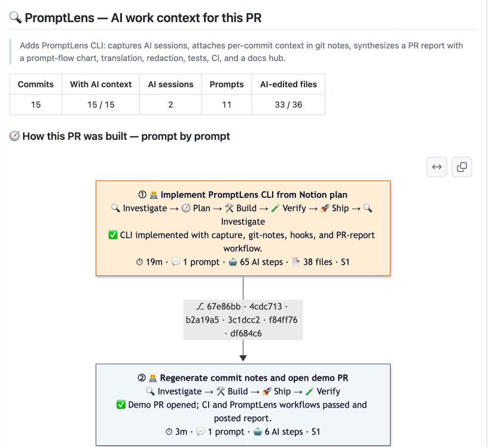
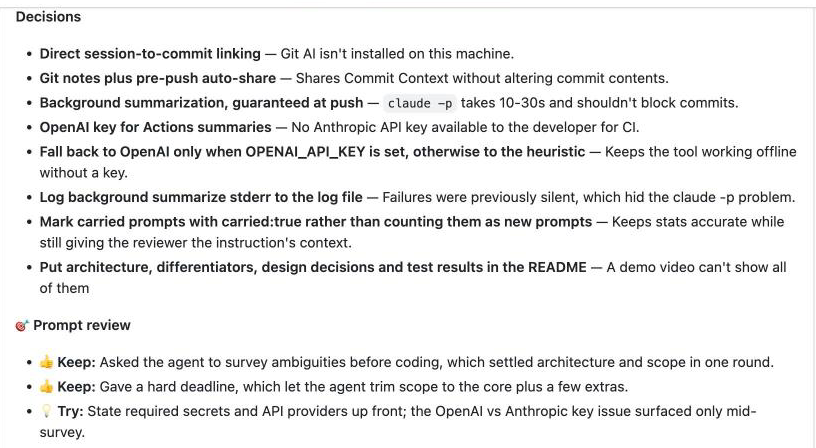
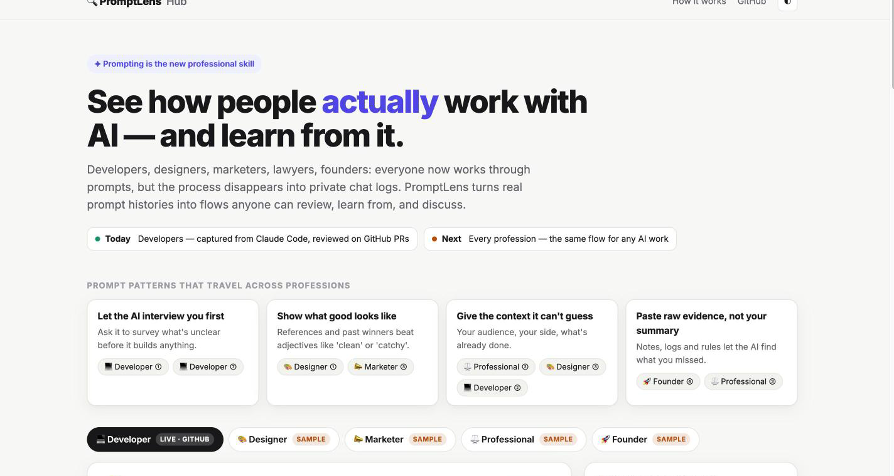

```mermaid
flowchart LR
  subgraph Dev["Developer machine"]
    CC["Claude Code sessions<br/>~/.claude/projects/*.jsonl"]
    PC["post-commit hook<br/><code>promptlens capture</code>"]
    RAW[".git/promptlens/raw/&lt;sha&gt;.json<br/>(private, never pushed)"]
    SUM["background summarizer<br/>claude -p → OpenAI → heuristic"]
    NOTE["git note<br/>refs/notes/promptlens"]
    PP["pre-push hook<br/><code>promptlens sync</code>"]
    CC --> PC --> RAW --> SUM --> NOTE --> PP
  end
  subgraph GH["GitHub"]
    REM["origin: branch + notes ref"]
    ACT["Actions: pull_request<br/>opened / synchronize"]
    CMT["One PR comment<br/>created or updated"]
    REM --> ACT --> CMT
  end
  PP -->|"push notes first, then branch"| REM
```

# 🔍 PromptLens

**Code review for the AI era: review the prompts, not just the diff.**

PromptLens records which AI coding sessions produced each commit and posts one auto-updating comment on every pull request. The comment shows what the developer asked for, what the AI did, what was decided, and whether anything was verified. The developer doesn't do any extra work to make that happen.

[](https://github.com/NewCodes7/promptlens/actions/workflows/ci.yml)


**[📄 Live PR report](https://github.com/NewCodes7/promptlens/pull/2)** · **[🌐 PromptLens Hub](https://newcodes7.github.io/promptlens/)** · **[⚡ Quick start](#-quick-start)** · **[🧠 How I solved it](#-the-hard-problems-and-how-i-solved-them)**
<!-- TODO: add the 90-second demo video link to the line above -->

<p align="center">
  
  <br>
  <sub><b>Real output, not a mockup.</b> This is the comment PromptLens posted on <a href="https://github.com/NewCodes7/promptlens/pull/1">its own PR #1</a>, which was built with Claude Code during the hackathon.</sub>
</p>

---

## 😩 The problem

**AI now writes code faster than people can review it.**

|                                                                                                                              |                                                                                                                                                           |
| ---------------------------------------------------------------------------------------------------------------------------- | --------------------------------------------------------------------------------------------------------------------------------------------------------- |
| **42%** of the code developers commit is already AI-generated or AI-assisted. Developers expect it to reach **65% by 2027**. | [Sonar, State of Code 2026](https://www.sonarsource.com/blog/state-of-code-developer-survey-report-the-current-reality-of-ai-coding/) (1,100+ developers) |
| **38%** of developers say reviewing AI-written code takes _more_ effort than reviewing a colleague's code.                   | same survey                                                                                                                                               |
| **96%** don't fully trust AI-generated code, yet only **48%** always check it before committing.                             | same survey                                                                                                                                               |

A diff shows **what** changed. It does not show **why**:

- what the developer actually asked for, and what they told the AI to avoid
- which alternatives the AI proposed and which ones the developer rejected
- whether anyone ran the tests

That context exists, but it's buried in a long private chat log. Sharing the whole log is noise, and writing a summary by hand is a chore nobody does. **So reviewers end up reverse-engineering intent from AI-written code.**

> **Who has this problem:** any developer who reviews code that someone else wrote _with_ an AI agent. Changes get bigger, the diff explains less, and the only way to learn the reasoning is to ask, or to read the conversation yourself.

## 💡 The solution: three steps, zero extra work

|     | Step                           | What happens                                                                                                                                                                                     |
| :-: | ------------------------------ | ------------------------------------------------------------------------------------------------------------------------------------------------------------------------------------------------ |
|  ①  | **Capture at commit**          | A `post-commit` hook links the commit to the Claude Code sessions that actually edited its files.                                                                                                |
|  ②  | **Preserve intent per commit** | A background job distills each capture into a small _Commit Context_ (intent, key prompts, decisions, AI work, verification) and attaches it to the commit SHA with `git notes`.                 |
|  ③  | **Report on the PR**           | GitHub Actions merges every commit's context with the final diff and posts **one** PR comment, updated on every push.                                                                            |
|  ④  | **Comment on a prompt**        | The same run commits `.promptlens/PR-<n>.md`, the prompt flow as plain Markdown, to the PR branch. Reviewers select lines in _Files changed_ and comment on a specific prompt, step or decision. |

Developers keep working as usual: `git commit`, `git push`, then open a PR from the web, `gh`, or an AI agent.

> **About the review file:** it is committed by the Actions bot, so run `git pull` before your next push. It is only rewritten when the commits change (no timestamps or LLM synthesis inside), so line comments don't go stale on every push. GitHub holds the workflow runs on that bot commit as _Action required_ instead of starting them, so there is no loop. Approving them is safe: the file is unchanged, so nothing is committed again. Fork PRs get a read-only token and keep the comment only. Pass `--no-review-file` to turn it off.

### What the reviewer gets

- **The PR at a glance:** a one-line summary, plus counts of commits with AI context, sessions, prompts, and AI-edited files.
- **🧭 How the PR was built, prompt by prompt:** a flow chart with one node per developer request. Each node shows the AI's steps, the outcome, time spent, and the commits it produced.
- **Per request:**
  - the developer's prompt, **quoted verbatim** (translated into English when needed, and labeled as translated)
  - what the AI did
  - decisions, including the developer's answers when the AI asked a question
  - verification
- **🎯 Prompt review:** _Keep_ / _Try_ feedback on how the developer prompted.
- **Where to focus your review:** AI-edited files with no recorded verification.
- **Open questions:** commits with no AI context, and claims the model inferred rather than read from the session.

<p align="center">
  
  <br>
  <sub>Expanding one request shows the reasons behind each decision and a review of the prompt itself.</sub>
</p>

## 🐶 Proof: PromptLens reviewed its own build

This repository was built with Claude Code during a 5-hour hackathon, with PromptLens running on itself. **[PR #1](https://github.com/NewCodes7/promptlens/pull/1)** is the result. **[PR #2](https://github.com/NewCodes7/promptlens/pull/2)** replays the same commits (plus the review file feature) as a live demo with both the comment and the line-commentable `.promptlens/PR-2.md`:

| Commits | With AI context | AI sessions | Developer prompts | AI-edited files | Request nodes in the flow |
| :-----: | :-------------: | :---------: | :---------------: | :-------------: | :-----------------------: |
|   15    |   **15 / 15**   |      2      |        11         |     33 / 36     |            10             |

None of this was written by hand: every commit was captured, summarized, and pushed by the hooks. PromptLens also reviewed _my_ prompting:

> 👍 **Keep:** Asked the agent to survey ambiguities before coding, which settled architecture and scope in one round.
> 💡 **Try:** State required secrets and API providers up front; the OpenAI vs Anthropic key issue surfaced only mid-survey.

Dogfooding also found real bugs that the unit tests didn't, and each fix shows up in the flow:

- Redaction was masking harmless config values, so it was narrowed to values that look like credentials.
- Pasted-content wrappers were leaking into the quoted prompts.
- `2>/dev/null` and read-only scripts were being counted as file edits.

## 📈 Why now, and where this goes

AI-assisted coding is becoming the default. The review step is where AI-written code either earns trust or quietly piles up risk. PromptLens starts there and expands outward:

|                                                                      | Who                                               | Value                                                                                                                                           |
| -------------------------------------------------------------------- | ------------------------------------------------- | ----------------------------------------------------------------------------------------------------------------------------------------------- |
| **Today: PR review**                                                 | Teams shipping with Claude Code, Codex, or Cursor | Reviewers understand intent in seconds instead of asking or digging through logs. Authors get reviewed without writing documentation.           |
| **Next: team insight**                                               | Engineering leads                                 | An audit trail of _why_ each AI change was made. See which prompting habits lead to verified, reviewable work, and spread them across the team. |
| **Later: [PromptLens Hub](https://newcodes7.github.io/promptlens/)** | Every profession that works through prompts       | A place to share and learn from real prompt flows, for developers, designers, marketers, lawyers, and founders.                                 |

**Why learning from other people's prompts matters:** using AI is a skill, and the gap is large.

- In an Anthropic study, developers who learned a new library with AI assistance scored **50%** on a follow-up quiz, compared with **67%** for those who coded by hand ([Anthropic, 2026](https://www.anthropic.com/research/AI-assistance-coding-skills)).
- Across about 400,000 Claude Code sessions, novices reached verified success **15%** of the time, compared with **28–33%** for intermediate and expert users ([Anthropic, 2026](https://www.anthropic.com/research/claude-code-expertise)).

Today that know-how disappears into private chats. PromptLens turns it into something people can review and learn from.

**Business model (hypothesis):**
- **For teams:** seat-based pricing for the PR integration and team analytics.
- **On the Hub:** a creator model like Medium. Some flows are free; authors publish premium prompt flows and earn from subscribers.

<p align="center">
  <a href="https://newcodes7.github.io/promptlens/"></a>
  <br>
  <sub>The Hub's Developer tab shows the <b>real</b> flow of PR #1, exported from <code>refs/notes/promptlens</code>. The Designer, Marketer, Professional, and Founder tabs are clearly labeled samples of the same format.</sub>
</p>

## 🏗 How it works



| Module                                                      | Responsibility                                                                                                                       |
| ----------------------------------------------------------- | ------------------------------------------------------------------------------------------------------------------------------------ |
| [`sessions.ts`](src/sessions.ts)                            | Parse Claude Code session logs into prompts, tool calls, and file edits. This is the adapter boundary for Codex, Cursor, and Git AI. |
| [`capture.ts`](src/capture.ts)                              | Link sessions to a commit by commit window × changed files, and carry forward instructions given earlier.                            |
| [`summarize.ts`](src/summarize.ts)                          | Build the per-commit Commit Context with `claude -p`, falling back to OpenAI and then to a heuristic.                                |
| [`turns.ts`](src/turns.ts) · [`flow.ts`](src/flow.ts)       | Split the work into one chunk per developer prompt and render the Mermaid flow and request details.                                  |
| [`report.ts`](src/report.ts) · [`github.ts`](src/github.ts) | Synthesize the PR against the final diff, and create or update the single comment.                                                   |
| [`redact.ts`](src/redact.ts)                                | Mask secrets and emails before anything leaves the machine.                                                                          |
| [`init.ts`](src/init.ts)                                    | Install hooks, notes config, and the workflow in one command.                                                                        |

## 🧠 The hard problems, and how I solved them

**1. There is no "PR created" hook.**
PRs get opened from the GitHub web UI, from `gh`, and by AI agents, so no hook sees all of them. But every path goes through a **commit**. PromptLens records context at commit time and stores it in `git notes`:
- No files are added to your tree.
- The note is keyed by SHA and survives `--amend` and `rebase` (`notes.rewriteRef`).
- `pre-push` pushes the notes ref _before_ the branch, so the Action always finds the context.

**2. Which of my sessions produced this commit?**
Developers run several sessions in parallel, keep one session going for hours, or open a session just to ask questions. A session is linked only if, **between the parent commit and this one, it edited a file this commit changed**:
- Edits are detected from Edit/Write tool calls and from shell writes (`sed -i`, heredocs, `tee`, scripts). Read-only commands and `2>/dev/null` are ignored.
- If the agent is still working on an instruction it received before the window, that prompt is carried forward and labeled as carried, so it isn't counted as a new prompt.

**3. Raw chat logs are unreadable.**
A single request can trigger 60+ agent actions, so PromptLens chunks the work **by developer prompt, not by agent action**:
- Each node is a request, with its steps normalized into eight types (Investigate · Plan · Build · Fix · Verify · Refactor · Docs · Ship).
- Long step lists are folded, and outcomes are rewritten for the request as a whole.
- The result is a Mermaid chart that renders natively in GitHub, with no extension needed.

**4. Can a reviewer trust an LLM's summary?**
- The model selects key prompts **by index**, and PromptLens quotes them verbatim from the log, so they are never paraphrased.
- Claims the model inferred are tagged _(inferred)_.
- Translations are labeled. The notes keep the original language; only the PR comment shows English.

**5. Prompts contain secrets and private thoughts.**
- The raw capture stays in `.git/promptlens/raw/` and is never pushed.
- Everything that leaves the machine goes through `redact()`, which covers OpenAI, Anthropic, GitHub, AWS, and Slack keys, JWTs, bearer tokens, private keys, credential assignments, and emails.
- The per-commit summary runs locally with `claude -p`, so raw prompts don't go to a third party. CI only sees the already-redacted notes.
- PromptLens marks its own summarizer prompts so they are never captured as your work.

**6. Never slow down `git commit`.**
- Capture is synchronous and fast. Summarizing (10–30 s) runs in the background, and `pre-push` fills in anything still missing.
- The LLM chain degrades gracefully: local `claude -p`, then OpenAI, then a heuristic. The tool still works offline and without API keys.

### PromptLens vs. existing tools

|                                       | Question it answers                                    | Looks at                                                 |
| ------------------------------------- | ------------------------------------------------------ | -------------------------------------------------------- |
| **Git AI** and other provenance tools | _Which lines did an AI write?_                         | Lines of code                                            |
| **AI code-review bots**               | _Is this diff correct?_                                | The diff                                                 |
| **PromptLens**                        | _**Why** was it written this way, and was it checked?_ | The prompts, decisions, and verification behind the diff |

These tools complement each other. PromptLens doesn't replace code review; it supplies the context that the code alone can't show.

## ⚡ Quick start

```bash
git clone https://github.com/NewCodes7/promptlens && cd promptlens && npm ci && npm run build
cd /path/to/your/repo
node /path/to/promptlens/dist/cli.js init   # hooks + notes config + .github/workflows/promptlens.yml
gh secret set OPENAI_API_KEY                 # optional: LLM synthesis of the PR summary
```

Then work as usual: commit, push, and open a PR.

> The npm package isn't published yet. The generated workflow calls `npx promptlens@latest`, so until it is published, point the workflow's last step at a build of this repo, as [this repo's own workflow](.github/workflows/promptlens.yml) does.

<details>
<summary><b>Commands and environment variables</b></summary>

| Command                              | When it runs   | What it does                                                                                                                |
| ------------------------------------ | -------------- | --------------------------------------------------------------------------------------------------------------------------- |
| `promptlens init`                    | once           | Installs `post-commit` / `pre-push` hooks (appending to existing ones), notes rewrite and fetch config, and the PR workflow |
| `promptlens capture [rev]`           | post-commit    | Links sessions to the commit, saves the private raw capture, and starts the background summarizer                           |
| `promptlens sync [remote]`           | pre-push       | Fills in any missing Commit Context and pushes the notes ref                                                                |
| `promptlens summarize [rev] --force` | manual         | Re-captures a commit and regenerates its context                                                                            |
| `promptlens show [rev]`              | manual         | Prints a commit's Commit Context                                                                                            |
| `promptlens report --base main`      | manual         | Previews the PR comment locally                                                                                             |
| `promptlens report --file`           | manual         | Previews the line-commentable review file                                                                                   |
| `promptlens pr-report --post`        | GitHub Actions | Commits`.promptlens/PR-<n>.md` to the PR branch, then creates or updates the PR comment                                     |

Environment variables:
- `OPENAI_API_KEY`
- `OPENAI_MODEL` (default `gpt-5-mini`)
- `PROMPTLENS_CLAUDE_MODEL` (default `sonnet`)
- `PROMPTLENS_PROVIDER=openai` skips the local Claude CLI.
- `PROMPTLENS_NO_LLM=1` disables LLM calls entirely.

</details>

## ✅ Quality

```bash
npm test          # 60 tests in 7 files
npm run coverage
```

| Module        | capture | flow | report | turns | redact | sessions | init |
| ------------- | :-----: | :--: | :----: | :---: | :----: | :------: | :--: |
| Line coverage |   98%   | 99%  |  99%   | 100%  |  100%  |   96%    | 90%  |
- **End-to-end test:** builds a real git repo with a fake Claude Code session log, then commits, captures, writes the note, and renders the PR report.
- **CI:** runs typecheck and coverage on every PR. The PromptLens workflow posts the report on its own PR.
- **Network adapters** (`github.ts`, `openai.ts`) and the CLI entrypoint are exercised by dogfooding on [PR #1](https://github.com/NewCodes7/promptlens/pull/1).

## 🗺 Limitations & roadmap

- **Claude Code only for now.** Codex, Cursor, and Git AI adapters plug in at `sessions.ts`.
- **Squash merges:** they rewrite SHAs, so notes don't follow the squash commit. The PR report is produced before the merge, so the review itself isn't affected.
- **Hub samples:** the Hub's non-developer tabs are samples. Capturing flows from other AI tools is next.
- **Next:**
  - an optional commit-time interview when a session lacks a clear "why"
  - ADR generation
  - team-level prompt analytics: which habits lead to verified work

## 🧰 Built with

TypeScript · Node 20 · git hooks & `git notes` · GitHub Actions · Claude Code (`claude -p`) · OpenAI · Mermaid · Vitest

## License

MIT
