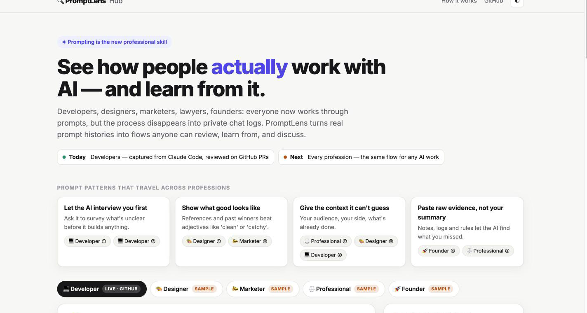

# PromptLens: why now, and where this goes

> This is the product vision behind PromptLens, written for the compiled hackathon (November 2026). The tool itself is documented in the [README](../README.md).

AI-assisted coding is becoming the default. The review step is where AI-written code either earns trust or quietly piles up risk. PromptLens starts there and expands outward:

|                                                                      | Who                                               | Value                                                                                                                                           |
| -------------------------------------------------------------------- | ------------------------------------------------- | ----------------------------------------------------------------------------------------------------------------------------------------------- |
| **Today: PR review**                                                 | Teams shipping with Claude Code, Codex, or Cursor | Reviewers understand intent in seconds instead of asking or digging through logs. Authors get reviewed without writing documentation.           |
| **Next: team insight**                                               | Engineering leads                                 | An audit trail of _why_ each AI change was made. See which prompting habits lead to verified, reviewable work, and spread them across the team. |
| **Later: [PromptLens Hub](https://newcodes7.github.io/promptlens/)** | Every profession that works through prompts       | A place to share and learn from real prompt flows, for developers, designers, marketers, lawyers, and founders.                                 |

**Why learning from other people's prompts matters:** using AI is a skill, and the gap is large.

- In an Anthropic study, developers who learned a new library with AI assistance scored **50%** on a follow-up quiz, compared with **67%** for those who coded by hand ([Anthropic, 2026](https://www.anthropic.com/research/AI-assistance-coding-skills)).
- Across about 400,000 Claude Code sessions, novices reached verified success **15%** of the time, compared with **28–33%** for intermediate and expert users ([Anthropic, 2026](https://www.anthropic.com/research/claude-code-expertise)).

Today that know-how disappears into private chats. PromptLens turns it into something people can review and learn from.

**Business model (hypothesis):**
- **For teams:** seat-based pricing for the PR integration and team analytics.
- **On the Hub:** a creator model like Medium. Some flows are free; authors publish premium prompt flows and earn from subscribers.

  
   
  The Hub's Developer tab shows the <b>real</b> flow of PR #1, exported from <code>refs/notes/promptlens</code>. The Designer, Marketer, Professional, and Founder tabs are clearly labeled samples of the same format.

